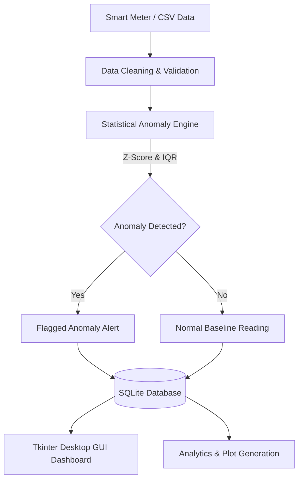

# ⚡ Electricity Anomaly Detector

An intelligent, end-to-end system for monitoring smart meter electricity readings, detecting abnormal consumption patterns (spikes, drops, and meter tampering), and visualizing energy trends with an interactive GUI and persistent SQLite database.

---

## 📌 Table of Contents
- [Overview](#overview)
- [Key Features](#key-features)
- [System Architecture](#system-architecture)
- [Project Structure](#project-structure)
- [Visualizations & Plots](#visualizations--plots)
- [Installation & Setup](#installation--setup)
- [Usage Guide](#usage-guide)
  - [1. Launching the Desktop GUI](#1-launching-the-desktop-gui)
  - [2. Running the Analytical Pipeline](#2-running-the-analytical-pipeline)
  - [3. Verifying the Database](#3-verifying-the-database)
- [Anomaly Detection Methodology](#anomaly-detection-methodology)
- [Database Schema](#database-schema)
- [License](#license)

---

## 🔍 Overview

With smart grid deployments expanding worldwide, detecting anomalies in electricity consumption is critical for:
- **Theft and Tampering Detection**: Identifying unauthorized power tapping or meter bypass.
- **Fault Detection**: Flagging malfunctioning appliances or damaged meters before major failures.
- **Consumer Insights**: Helping consumers identify unintentional energy leaks or excessive appliance runtimes.

This repository provides a modular, production-ready implementation combining robust statistical anomaly algorithms, a local SQLite datastore, automated plot generators, and a modern Tkinter GUI dashboard.

---

## ✨ Key Features

- **Interactive Desktop Application (`gui.py`)**:
  - Secure login interface for operators.
  - Interactive dashboard with real-time summary statistics (total readings, detected anomalies, average consumption).
  - Manual & batch reading entry forms with instant anomaly evaluation.
  - Embedded Matplotlib visualizer for trend analysis.
  - Data table viewer with filtering, sorting, and export capabilities.

- **Statistical Anomaly Detection (`electricity_anomaly_detector.py`)**:
  - Dynamic Z-Score and Interquartile Range (IQR) thresholding.
  - Identification of consumption spikes, drops, and abnormal baseline shifts.
  - Household-level and aggregate consumption profiling.

- **Persistent SQLite Datastore (`database.py`)**:
  - Lightweight, serverless local database (`electricity_anomaly_detector.db`).
  - Stores raw meter readings, sensor measurements, timestamps, appliance breakdowns, and detection flags.
  - Automatic migration from historical CSV records.

- **Rich Data Analytics & Visualizations (`plots/`)**:
  - Automatically exports publication-ready visualizations of consumption distributions, weekly/monthly patterns, correlation heatmaps, and household anomaly rankings.

- **Automated Verification Suite (`verify_database.py`)**:
  - Unit-style integration script testing schema integrity, reading retrieval, and anomaly classification.

---

## 🏗️ System Architecture



---

## 📂 Project Structure

```
electricity-anomaly/
├── daily_dataset.csv                   # Raw household daily energy dataset
├── processed_daily_dataset.csv         # Cleaned and processed dataset
├── meter_readings.csv                  # Sample reading stream for database seeding
├── electricity_anomaly_detector.db     # SQLite database for persistent storage
├── database.py                         # SQLite schema, queries, and CRUD operations
├── electricity_anomaly_detector.py     # Data cleaning, EDA, and anomaly detection engine
├── gui.py                              # Interactive Tkinter desktop application
├── verify_database.py                  # Integration and verification test script
├── requirements.txt                    # Project dependencies
├── .gitignore                          # Git ignore configuration
├── electricity_anomaly_detector.pptx   # Project presentation deck
├── Electricity_Anomaly_Detector_Dashboard (2).xlsx # Excel analytics dashboard
└── plots/                              # Generated visual analytics
    ├── anomalies_scatter_plot.png
    ├── average_consumption_by_day_of_week.png
    ├── average_daily_consumption_trend.png
    ├── correlation_heatmap.png
    ├── energy_consumption_distribution.png
    ├── monthly_consumption_distribution.png
    ├── top_10_households_by_anomaly_rate.png
    └── weekly_consumption_trend.png
```

---

## 📊 Visualizations & Plots

The analytical pipeline generates detailed charts stored in the `plots/` directory:

| Visualization | Description |
| :--- | :--- |
| **`anomalies_scatter_plot.png`** | Highlights detected consumption anomalies against normal readings across time. |
| **`average_daily_consumption_trend.png`** | Tracks daily mean energy usage across all monitored meters. |
| **`weekly_consumption_trend.png`** | Illustrates cyclical patterns and weekly consumption cycles. |
| **`average_consumption_by_day_of_week.png`** | Compares consumption between weekdays and weekends. |
| **`monthly_consumption_distribution.png`** | Depicts seasonal shifts in energy demand across months. |
| **`energy_consumption_distribution.png`** | Histogram and KDE showing frequency of consumption values. |
| **`correlation_heatmap.png`** | Correlation matrix between consumption, time metrics, and household features. |
| **`top_10_households_by_anomaly_rate.png`** | Identifies households with the highest frequency of anomalous consumption. |

---

## 🚀 Installation & Setup

### 1. Prerequisites
- **Python 3.8 or higher** installed on your system.
- Ensure `pip` is updated:
  ```bash
  python -m pip install --upgrade pip
  ```

### 2. Clone the Repository
```bash
git clone https://github.com/<your-username>/electricity-anomaly.git
cd electricity-anomaly
```

### 3. Create a Virtual Environment (Recommended)
```bash
# Windows
python -m venv venv
venv\Scripts\activate

# macOS / Linux
python3 -m venv venv
source venv/bin/activate
```

### 4. Install Dependencies
```bash
pip install -r requirements.txt
```

---

## 💻 Usage Guide

### 1. Launching the Desktop GUI
To open the interactive control dashboard:
```bash
python gui.py
```
- **Default Credentials**: Username: `admin` | Password: `admin123`
- From the GUI, you can inspect readings, test live inputs, review detected anomalies, and view visualizations.

### 2. Running the Analytical Pipeline
To run the full cleaning, statistical anomaly detection, and chart generation workflow:
```bash
python electricity_anomaly_detector.py
```
All generated charts are automatically saved into the `plots/` folder.

### 3. Verifying the Database
To run the end-to-end verification and schema integrity suite:
```bash
python verify_database.py
```

---

## 🔬 Anomaly Detection Methodology

1. **Interquartile Range (IQR) Filter**:
   - Computes $Q_1$ (25th percentile) and $Q_3$ (75th percentile).
   - Identifies outliers lying outside $[Q_1 - 1.5 \times \text{IQR},\ Q_3 + 1.5 \times \text{IQR}]$.
2. **Z-Score Normalization**:
   - Standardizes readings: $Z = \frac{X - \mu}{\sigma}$.
   - Points with $|Z| > 3.0$ are flagged as extreme deviations.
3. **Appliance & Duration Heuristics**:
   - Flags sudden spikes exceeding expected appliance capacity and continuous non-stop high loads.

---

## 🗄️ Database Schema

The SQLite database (`electricity_anomaly_detector.db`) manages two main tables:

### `meter_readings`
| Column | Type | Description |
| :--- | :--- | :--- |
| `id` | INTEGER | Primary Key (Autoincrement) |
| `timestamp` | TEXT | Reading date and time |
| `household_id` | TEXT | Unique identifier for household meter |
| `month` | TEXT | Month of reading |
| `meter_reading_kwh` | REAL | Energy consumed in kilowatt-hours |
| `bill_amount` | REAL | Computed billing cost |
| `appliance` | TEXT | Primary appliance reported |
| `usage_hours_per_day` | REAL | Daily hours of operation |

### `daily_anomalies`
| Column | Type | Description |
| :--- | :--- | :--- |
| `id` | INTEGER | Primary Key (Autoincrement) |
| `household_id` | TEXT | Household identifier |
| `date` | TEXT | Date anomaly detected |
| `energy_median` | REAL | Median daily energy |
| `energy_mean` | REAL | Mean daily energy |
| `anomaly_score` | REAL | Severity score of anomaly |
| `is_anomaly` | INTEGER | Flag (1 = Anomaly, 0 = Normal) |

---

## 📄 License

This project is licensed under the [MIT License](LICENSE).
